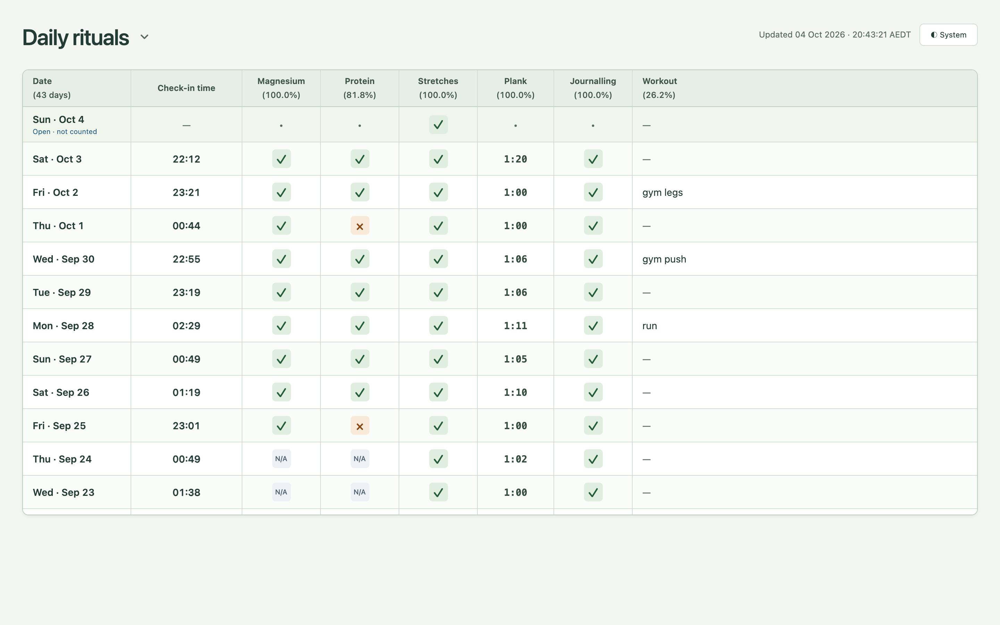
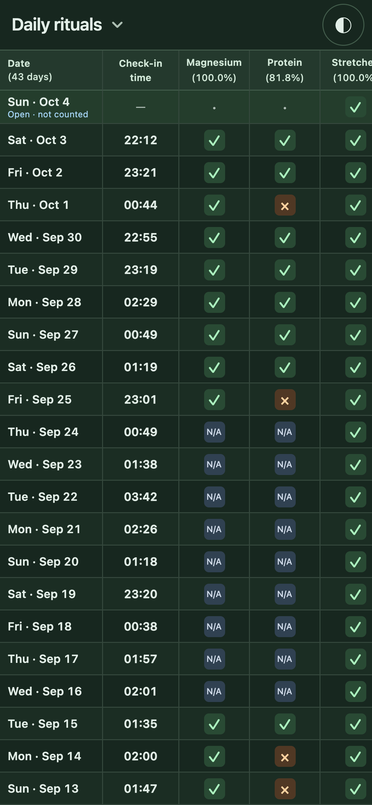

# Rituals

A small, local-first habit tracker (daily rituals plus a weekly review) that a chat assistant keeps for you. You tell your assistant what you did ("magnesium and protein done, 70 second plank", "checking in", "gym push: bench 3x8"); it logs that into a SQLite database on your Mac through one command-line tool, keeping your exact words as evidence. A read-only dashboard shows the result on your phone over your private Tailscale network.

<p align="center">
  
  
</p>

The screenshots show my real data. This is my personal setup, shared so you (or, more likely, your agent) can see how it fits together and adapt it. It is not a packaged product: expect to change things. There are no dependencies to install; the code is plain Python 3 from macOS, a little HTML/JS, and one small Objective-C app.

## How it works

```
you ──message──▶ your assistant ──JSON on stdin──▶ bin/ritualctl ──▶ data/ritual.sqlite3
                                                                      │  (records + audit log
                                                                      │   + automatic backups)
                         data/views/*.html (daily, weekly) ◀──────────┤  static snapshots
phone ──Tailscale Serve (private HTTPS)──▶ 127.0.0.1:8765 ◀───────────┘  live read-only API
                                           (native menu-bar app + LaunchAgent)
```

- **One write path.** Every change goes through `bin/ritualctl` as one JSON request with a stable `request_id` and the original words in `source_text`. Retrying the same request is harmless; reusing an ID with a different payload is rejected; corrections need the record's current revision. Every change lands in an audit table with before/after values.
- **Unknown stays unknown.** Reports merge field by field, so "did my stretches" doesn't erase an earlier "magnesium yes", and a missing value stays null rather than becoming "no".
- **Evenings close at noon.** A day's rituals stay open until noon the next day in the store's timezone, so after-midnight reports still count for the evening. After that, missing values are shown as not done. Open days and N/A periods are left out of the percentages.
- **Offline queue.** If the database can't be written, requests can be queued (`--enqueue`) and replayed in order later (`--replay`), stopping at the first conflict.
- **Read-only dashboard.** The live server only answers GET/HEAD for its two pages, `/` (Daily rituals) and `/weekly` (Weekly review), and their `/api/dashboard` and `/api/weekly`, only on loopback, only for the one Tailscale login named in its config (Tailscale Serve adds that identity header), and opens SQLite read-only. Notes, source text, audit history and workout details never leave the API; the weekly page shows only each week's answer.

## What it tracks

| Table | Fields |
|---|---|
| `rituals` (one row per date) | `checkins` (evening check-in instants), `magnesium`, `protein`, `stretching`, `journalling` (true/false/null), `plank_seconds`, `notes` |
| `workouts` | exactly `id, date, type, details`; `type` is free text, several per day allowed |
| `reminders` | `text`, optional `due_at`, status pending/delivered/done/cancelled |
| `applicability_exceptions` | date ranges where a habit doesn't apply (shown as N/A) |
| `weekly_reviews` (one row per week) | `week_start` (the Monday), `answer` (what got done that week) |
| `changes`, `source_documents`, `legacy_checkpoints`, `imports` | audit log and original evidence |

## Quickstart

On macOS, from a fresh clone:

```sh
bin/ritualctl --init                 # create an empty data/ritual.sqlite3 (refuses if one exists)
bin/ritualctl <<'JSON'
{"op":"ritual_put","date":"2026-10-03","patch":{"protein":true,"plank_seconds":70},
 "request_id":"msg-1:ritual","source_text":"protein done, 70 second plank. Received 2026-10-03T21:40:00+10:00"}
JSON
open data/views/ritual-dashboard.html   # the static snapshot regenerates after each write
bin/ritual-tests && bin/ritual-tests --smoke
```

Every request type, with templates, is in [HANDOFF.md](HANDOFF.md) (reads, writes, corrections, reminders, workouts, exceptions, queue and replay, backup, export and restore). `data/` and everything personal is in `.gitignore`.

To serve the live dashboard to your phone, follow "Setting up the dashboard service" in HANDOFF.md. You need a config file (template in `examples/dashboard-server.json`), the native host app (`native/build.sh`), a LaunchAgent (template in `examples/local.ritual-dashboard.plist`) and `tailscale serve`.

## Built for agents taking turns

The repo is set up so several AI agents (or sessions) can work on it one after another without a shared memory:

- [`AGENTS.md`](AGENTS.md) is the entry point and the only file with authority: logging rules, date rules, privacy rules and how to take turns.
- [`HANDOFF.md`](HANDOFF.md) is the cookbook: exact commands for every operation.
- [`PROGRESS.md`](PROGRESS.md) is the turn log: each agent appends what it changed, how it tested and what is still open.
- `LOCAL.md` and `PROGRESS.local.md` (ignored by git) hold one installation's private details: its paths, dashboard URL, assistant schedule and history notes. AGENTS.md says to read them when present. That split is what lets the same tracked files serve as both my live instructions and this public repo.
- `bin/ritual-agent claim OWNER SCOPE` is a cooperative lock for landing code or deploying in the live folder; logging needs no claim because the database's transactions, idempotent request IDs and revision checks already make sequential writers safe.
- Code changes happen on a branch in a separate clone or worktree and land in the live folder as a fast-forward of `main`.

An example of the kind of schedule an assistant can run on top of this (mine, roughly): at noon, review stashed reminders; at 22:00, a short check-in invitation and the evening checklist; on Sundays, ask "What did you get done this week?" and record the answer with `weekly_put`.

## Adapting it

Things you will probably want to change:

| What | Where |
|---|---|
| The habits | They are real columns, so changing them needs a schema migration. Every place a habit is named: `app/ritual.py` (the `rituals` table columns in `SCHEMA`, `BOOLS`, `FIELDS`, and the plank special cases in the applicability conflict checks), `app/applicability.py` (`HABITS` and the `CHECK` constraint in `TABLE_SQL`), `app/dashboard.py` (the `SELECT` in `read_records` and the per-habit cells in `render`), `app/dashboard_web.py` (the `HABITS` labels and the frontend `habits` array in `DAILY_SCRIPT`), `tests/check_ui.cjs` (fixture row) and the tests. Planks are the one numeric habit (`plank_seconds`); the rest are true/false/null. |
| Timezone | `Australia/Melbourne`: the `TZ` definitions in `app/ritual.py` and `app/applicability.py` (they load the bundled `app/Melbourne.tzif`, so they work on the macOS system Python without `tzdata`), and the `timezone` labels in `app/ritual.py`, `app/applicability.py` and `app/dashboard_web.py`. |
| Port | `8765` in `app/dashboard_server.py` (config check) and `app/service_control.py`. |
| Service names | LaunchAgent label `local.ritual-dashboard` (`app/service_control.py`), app path `~/Applications/Ritual Dashboard.app` (`app/service_control.py`), bundle ID in `native/Info.plist` and `native/build.sh`. |
| Store location for the app | Passed to `native/build.sh OUTPUT_APP STORE_ROOT`, stored in the app's Info.plist. |
| Python and Chrome | `/usr/bin/python3` in every `bin/` script; Chrome path in `tests/playwright.cjs`. |
| Not on a Mac / no Tailscale | The CLI, store and static snapshot are plain Python and should run anywhere with Python 3.9+. Only the native app, `bin/ritual-service` and the identity check in `app/dashboard_server.py` assume macOS and Tailscale. |

## Project map

| Path | Purpose |
|---|---|
| `app/ritual.py`, `app/applicability.py` | SQLite transactions, validation, audit, applicability and date rules |
| `app/local_client.py`, `bin/ritualctl` | Local writes, init, idempotency, durable queue and replay |
| `app/dashboard.py` | Shared matrix, weekly view, title bar with the ritual picker, formatting and static snapshots |
| `app/dashboard_web.py`, `app/dashboard_theme.py` | Live read projections, frontends, theme and picker script |
| `app/dashboard_server.py` | Private read-only HTTP service (config in ignored `config/dashboard-server.json`) |
| `app/service_control.py`, `bin/ritual-service` | Start/stop/status for the existing LaunchAgent |
| `app/agent_work.py`, `bin/ritual-agent` | Cooperative edit claims between agents |
| `native/` | Menu-bar host app source and build script |
| `examples/` | Templates for the server config and the LaunchAgent |
| `tests/`, `bin/ritual-tests`, `bin/ritual-ui-check` | Backend tests on made-up fixtures, and browser checks |
| `tools/screenshots.cjs`, `bin/ritual-screenshots`, `docs/screenshots/` | Regenerates the README images from a read-only copy of the data |
| `AGENTS.md`, `HANDOFF.md`, `PROGRESS.md` | Agent instructions, operating cookbook and turn log |

Ignored and created at runtime: `data/` (database, backups, exports, snapshot), `queue/`, `evidence/`, `logs/`, `config/`, `LOCAL.md`, `PROGRESS.local.md`.

## Requirements

- macOS with its system Python 3 (3.9 or later). No Python packages.
- For the live dashboard: Tailscale, and Xcode command line tools to build the host app.
- For `bin/ritual-ui-check` and `bin/ritual-screenshots`: Node, an existing Playwright module (found automatically, or set `RITUAL_PLAYWRIGHT_MODULE`) and Google Chrome. Nothing is installed for you.

## Licence

MIT. See [LICENSE](LICENSE).
